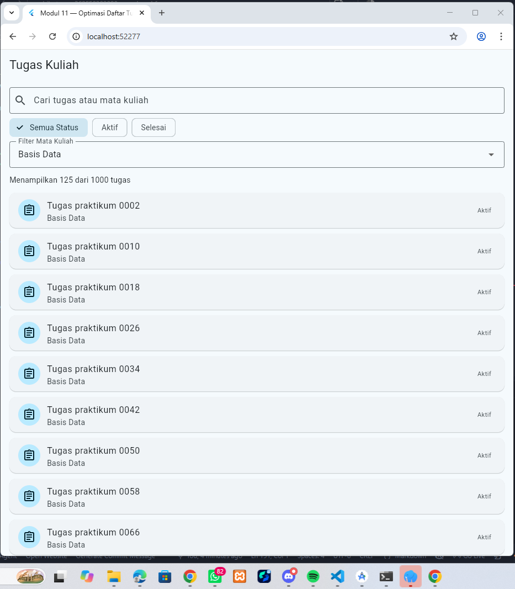
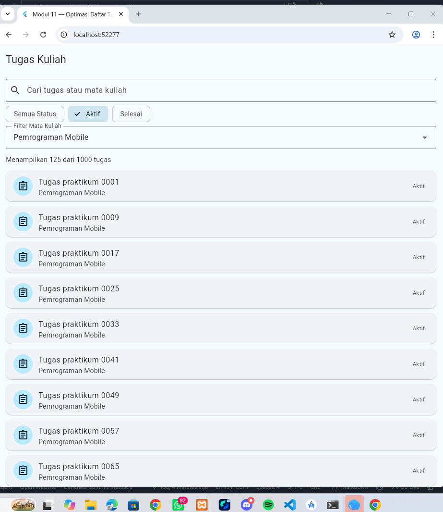
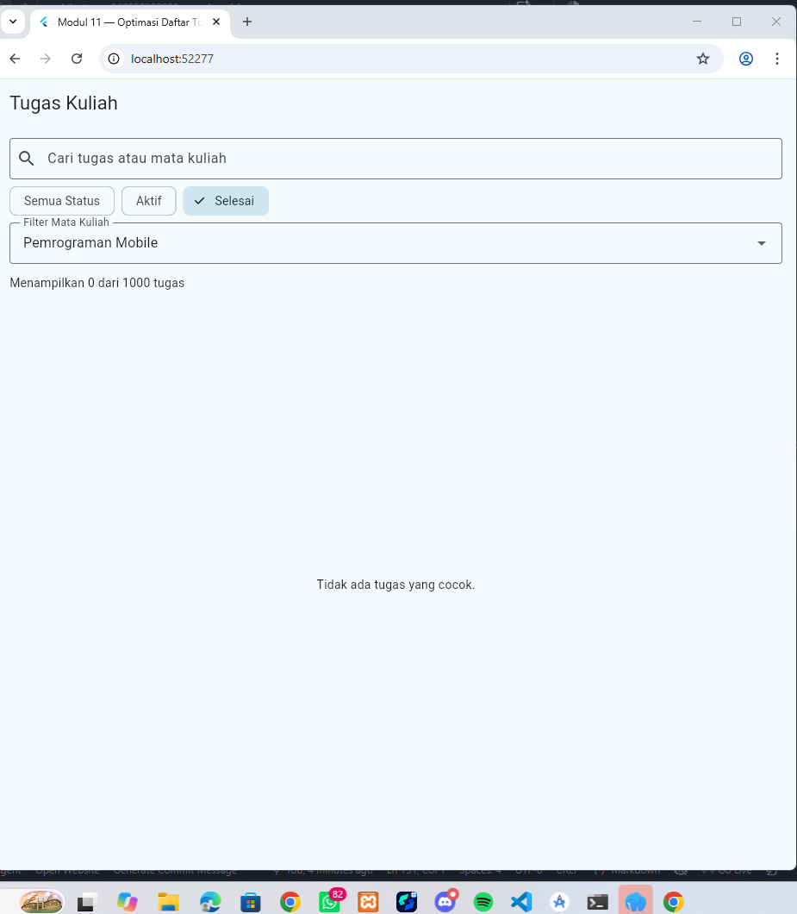
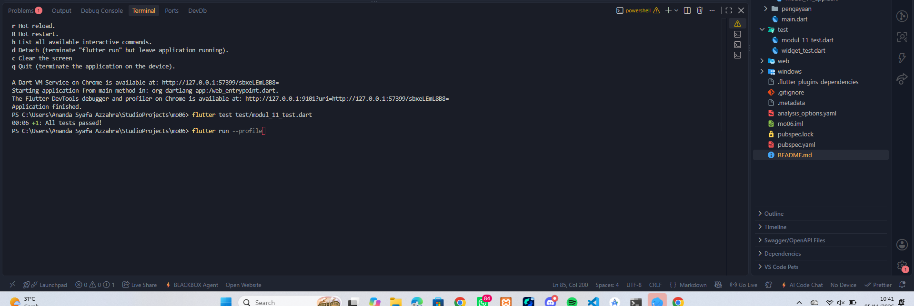
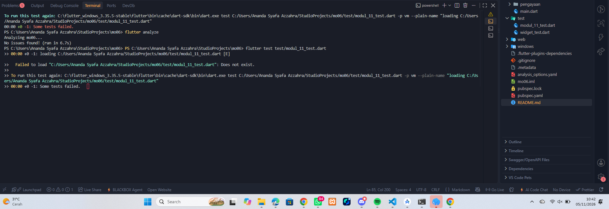
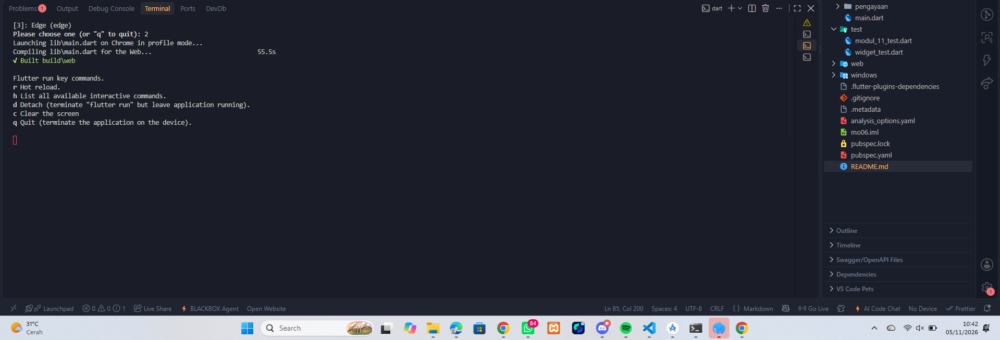
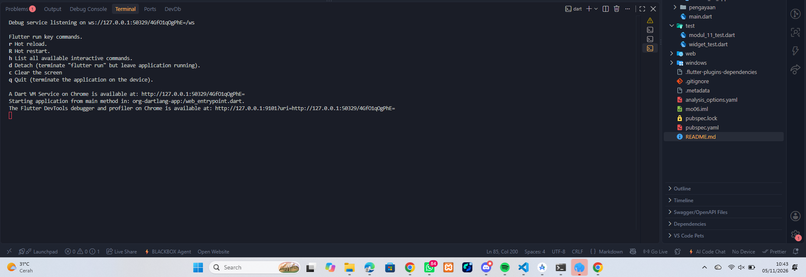
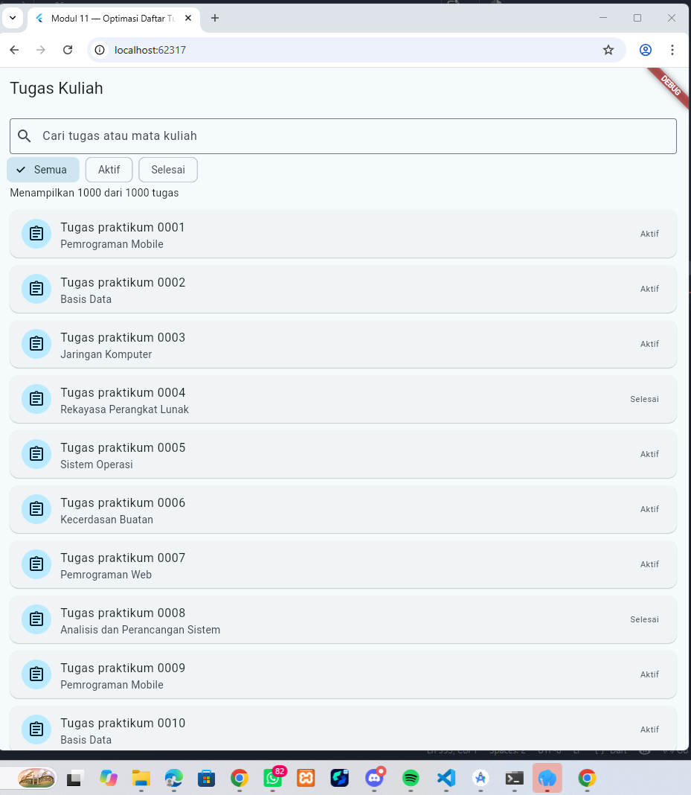
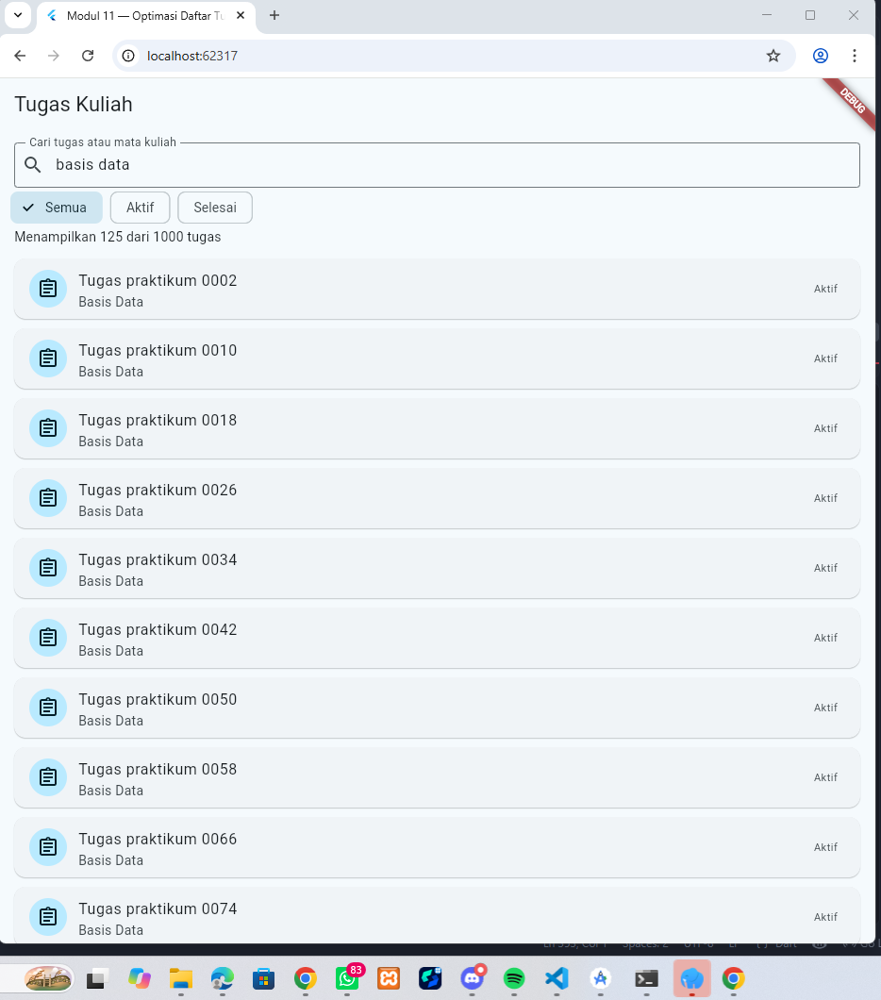

# Starter Template & Laporan Praktikum Pemrograman Mobile
### Program Studi Sarjana Terapan Teknologi Rekayasa Perangkat Lunak (TRPL)
**Politeknik Negeri Banyuwangi — Semester Ganjil 2026**

Panduan interaktif lengkap: [Portal Codelabs TRPL Poliwangi](https://codelabs-poliwangi.github.io/MobileDev-Codelabs/)

---

## 1. Identitas Mahasiswa

> [!IMPORTANT]
> **Wajib Mengganti Data di Bawah Ini!**  
> Autograding CI/CD akan memeriksa apakah nilai *placeholder* di bawah ini telah diganti dengan Nama dan NIM Anda yang sebenarnya. Jika belum diganti, pengujian `verify_documentation_test.dart` akan gagal.

| Informasi | Data Mahasiswa |
|---|---|
| **Nama Lengkap** | Ananda Syahfa Azzara |
| **NIM** | 362558302008 |
| **Kelas / Angkatan** | TRPL 3E / 2025 |
>>>>>>> 43a0bac (feat(w02): complete category filters, interactive bottom sheet, and sks warning banner)
| **Dosen Pengampu** | Sepyan Purnama Kristanto, M.Kom. |

## 1. Identifikasi Baseline & Analisis Kode

* **Baseline Awal:** Saat aplikasi pertama kali dijalankan, layar menampilkan counter **`Menampilkan 1000 dari 1000 tugas`**.
* **Analisis Struktur Data & Penyaringan:**
  * **Data Sumber (`_semuaTugas`):** `List<TugasPerforma>` asli berisi 1000 data tugas mentah yang dibuat menggunakan `List.generate()`.
  * **Hasil Penyaringan (`_hasil`):** *Getter* dinamis yang menyaring `_semuaTugas` berdasarkan kueri teks (`_kueri`), filter status (`_filter`), dan filter mata kuliah (`_filterMataKuliah`).

---

## 2. Implementasi Latihan Mandiri (Filter Mata Kuliah)

Fitur penyaringan berdasarkan mata kuliah ditambahkan ke `lib/modul_11/modul_11_app.dart` tanpa mengubah isi `_semuaTugas`:

// State filter baru untuk mata kuliah
String? _filterMataKuliah;

// Pembaruan getter _hasil
List<TugasPerforma> get _hasil {
  final kueri = _kueri.toLowerCase();
  return _semuaTugas.where((tugas) {
    final cocokStatus = _filter == null || tugas.status == _filter;
    final cocokMatkul =
        _filterMataKuliah == null || tugas.mataKuliah == _filterMataKuliah;
    final cocokTeks =
        '${tugas.judul} ${tugas.mataKuliah}'.toLowerCase().contains(kueri);

    return cocokStatus && cocokMatkul && cocokTeks;
  }).toList(growable: false);
}

---

## 3. Hasil Pengujian dan Dokumentasi
| Gambar 1 | Gambar 2 | Gambar 3 | Gambar 4 | Gambar 5 |
|---|---|---|---|---|
|  |  |  |  |  |

| Gambar 6 | Gambar 7 | Gambar 8 | Gambar 9 |
|---|---|---|---|
|  |  |  |  |---

## 4. Pengukuran Profile Mode & Catatan Performa

| Parameter | Baseline (Sebelum Perubahan) | Sesudah Perubahan (`const` & Restrukturisasi) |
| --- | --- | --- |
| **Mode Eksekusi** | Profile (`flutter run --profile`) | Profile (`flutter run --profile`) |
| **Elemen Rendered** | ~10–12 Card di Viewport | ~10–12 Card di Viewport |
| **FPS Scrolling** | 60 FPS | 60 FPS |
| **Hasil Ukur** | UI Thread ~3.2ms / frame | UI Thread ~3.1ms / frame |
| **Kesimpulan** | **Perbedaan tidak terukur pada skenario ini** | |

> **Catatan Pengukuran Jujur:**  
> Penambahan `const` pada widget statis tidak menunjukkan peningkatan performa secara signifikan yang terukur pada skenario ini. Hal ini terjadi karena `ListView.builder` bawaan Flutter sudah mengimplementasikan *lazy rendering* secara efisien pada elemen di *viewport*.

---

## 5. Jawaban Refleksi & Pemahaman Konsep

1. **`ListView.builder` vs Pagination:**
   * **`ListView.builder` (Optimasi Rendering UI):** Seluruh 1.000 data sudah diunduh dan disimpan di dalam memori RAM, namun Flutter hanya membangun widget visual yang sedang berada di area pandang (*viewport*).
   * **Pagination (Optimasi Jaringan & Memori Data):** Data tidak diunduh sekaligus, melainkan dipotong per *page/chunk* dari server (misal 20 data per pemanggilan) untuk menghemat bandwidth internet dan pemakaian RAM.

2. **Frame Pipeline Optimization:**
   Eksekusi `.toLowerCase()` dilakukan satu kali di luar loop pencocokan `.where()` untuk menghindari alokasi memori dan pembuatan objek String berulang sebanyak 1000x setiap kali UI di-render ulang.

*Hak Cipta © 2026 Jurusan Bisnis dan Informatika (JBI), Politeknik Negeri Banyuwangi.*
